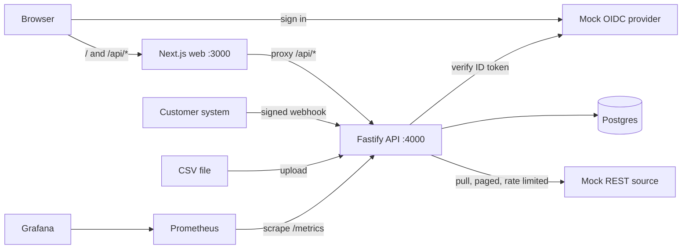
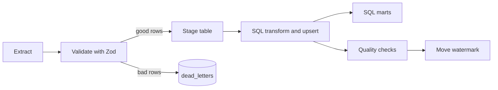

# Customer Integration Console

A TypeScript full-stack app that a forward deployed engineer could build for a customer. Connect data sources, run pipelines, see health and data quality, and keep an audit trail of who did what.


## What it does

- **Sources:** CSV upload, a REST API (cursor paging, API key, rate limit with retry), and a signed webhook.
- **Pipeline:** extract, validate with Zod, stage, transform with plain SQL files, load into Postgres. Incremental loads with a watermark. Safe to re-run.
- **Dead letters:** bad rows are parked with the reason. You can edit the row and replay it from the UI.
- **Data quality:** null check, duplicate keys, schema drift and validation rate. Stored for every run and shown as a scorecard.
- **Access:** single sign-on through OpenID Connect (a small mock provider runs locally), session cookies, three roles (admin, engineer, viewer), CSRF protection, append-only audit log.
- **Operations:** structured JSON logs, a Prometheus `/metrics` endpoint, a Grafana dashboard, Dockerfiles, Compose, Kubernetes manifests, Terraform for GCP, GitHub Actions.

## Architecture



Pipeline inside one run (one database transaction):



More: [OpenAPI](docs/openapi.json), [ONBOARDING](docs/ONBOARDING.md), [RUNBOOK](docs/RUNBOOK.md), [DEMO](docs/DEMO.md), [DECISIONS](docs/DECISIONS.md), [SECURITY](SECURITY.md), [LEARN](LEARN.md).

## Screenshots

| Sources | Dead letters | Audit log |
|---|---|---|
|  |  |  |

## Run it

You need Node 22. The stack script also needs the PostgreSQL server binaries (`initdb`, `pg_ctl`) on your PATH. It starts a throw-away database, so no Docker is needed.

```bash
npm install
npm run stack        # prints the URLs, uses random free ports
```

Open the web URL, click "Sign in with SSO", pick a test user:

| User | Role |
|---|---|
| Alice Admin | admin: everything, audit log, delete sources |
| Bob Engineer | engineer: create sources, run, upload, replay |
| Carol Viewer | viewer: read only |

The mock REST source needs the API key `demo-key`. Sample files are in `sample-data/`.

### With Docker

```bash
cp .env.example .env
docker compose up --build                              # web :3000, mock IdP :4100, mock source :4200
docker compose --profile observability up --build      # adds Prometheus :9090 and Grafana :3001
```

## Test it

```bash
npm run lint
npm run typecheck
npm test            # vitest, starts its own throw-away Postgres (or set TEST_DATABASE_URL)
npm run e2e         # Playwright on the full local stack (needs: npx playwright install chromium)
npm run openapi     # regenerates docs/openapi.json from the route table
```

## What was verified (2026-11-07, on the build machine)

| Check | Result |
|---|---|
| `npm test` | 99 tests, 6 files, all pass |
| `npm run e2e` | 7 Playwright tests pass on the local stack |
| `npm run lint`, `npm run typecheck` | clean |
| `npm audit --audit-level=high` | no high or critical findings; 7 moderate remain in a dev-only lint dependency (minimatch) |
| `next build`, `tsc` build of the API | succeed; the built API starts and answers `/health` |
| `podman build` of the three Dockerfiles | succeed |
| `podman-compose config` on `docker-compose.yml` | valid |

## What was NOT verified

- `docker compose up` was not run end to end (Docker is not installed here). The images build, and the stack runs through `npm run stack`.
- Prometheus and Grafana were not started. A test checks that the dashboard only queries metrics the API exports.
- Kubernetes: `kubectl` and `kubeconform` are not installed. A vitest file checks the manifests (probes, limits, selectors, HPA targets, no secrets). CI runs kubeconform, but that has not run.
- Terraform: not installed, so `terraform validate` was not run. Nothing was applied.
- The GitHub Actions workflow has never run.

See [LEARN.md](LEARN.md) for the list of simplifications.

## Layout

```
api/      Fastify API, pipeline, SQL migrations and transforms, tests
web/      Next.js (App Router), Tailwind, Recharts
mocks/    mock OIDC provider and mock REST source
e2e/      Playwright tests (they also take the README screenshots)
k8s/ infra/ observability/ docs/ scripts/ sample-data/
```

License: MIT, copyright Stanley Sujith Nelavala.
