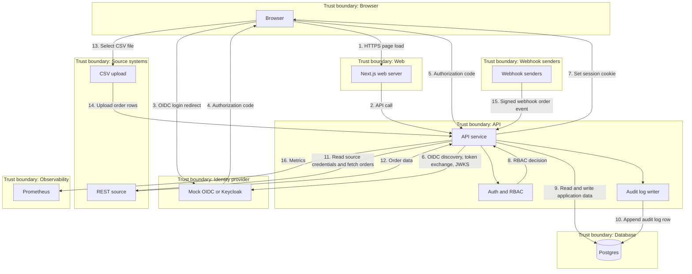

# Architecture

## Metadata
- Label: architecture and data-flow diagram
- Date: 2026-11-09
- Code commit: f1e553a
- Machine: local workstation
- Command: none
- Notes: Data-flow diagram and trust boundaries for FoodDistCo.
---

## Data-flow diagram

## Trust boundaries

1. Browser. The user interface runs on a customer device.
2. Web. The Next.js web server renders the UI and forwards requests.
3. API. The API service checks auth and RBAC. It writes audit log rows.
4. Identity provider. The mock OIDC server or Keycloak issues identity tokens.
5. Database. Postgres stores orders, source credentials, sessions, and audit log rows.
6. Source systems. CSV upload and REST source provide order data.
7. Webhook senders. Signed webhook providers send order events.
8. Observability. Prometheus scrapes metrics from the API.

## Numbered data flows

1. Browser loads the web UI from the web server.
2. Web server calls the API.
3. Browser starts OIDC login at the identity provider.
4. Identity provider returns an authorization code to the browser.
5. Browser sends the authorization code to the API.
6. API performs OIDC discovery and token exchange with the identity provider.
7. API sets a session cookie in the browser.
8. API checks the session and RBAC decision.
9. API reads and writes application data in Postgres.
10. API appends an audit log row in Postgres.
11. API reads source credentials from Postgres and calls the REST source.
12. REST source returns order data to the API.
13. Browser selects a CSV file for upload.
14. CSV upload sends order rows to the API.
15. Webhook senders send signed order events to the API.
16. API exposes metrics to Prometheus.
