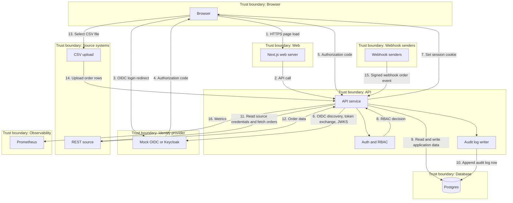
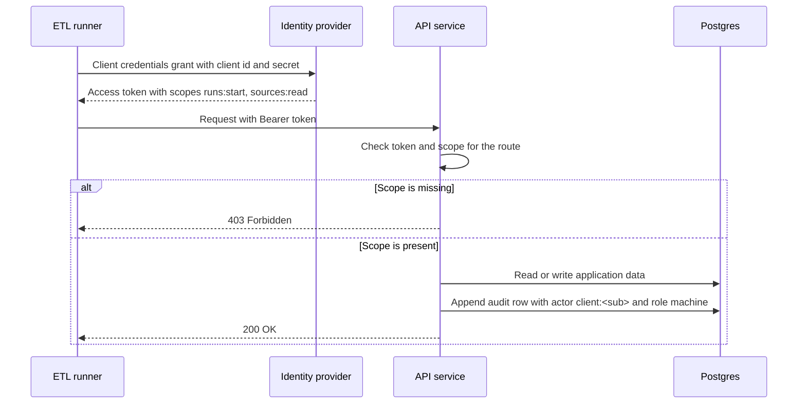

# Architecture

## Metadata
- Label: architecture and data-flow diagram
- Date: 2026-11-09
- Code commit: f1e553a
- Machine: local workstation
- Command: none
- Notes: Data-flow diagram and trust boundaries for FoodDistCo.
---

## Data-flow diagram

## Trust boundaries

1. Browser. The user interface runs on a customer device.
2. Web. The Next.js web server renders the UI and forwards requests.
3. API. The API service checks auth and RBAC. It writes audit log rows.
4. Identity provider. The mock OIDC server or Keycloak issues identity tokens.
5. Database. Postgres stores orders, source credentials, sessions, and audit log rows.
6. Source systems. CSV upload and REST source provide order data.
7. Webhook senders. Signed webhook providers send order events.
8. Observability. Prometheus scrapes metrics from the API.

## Numbered data flows

1. Browser loads the web UI from the web server.
2. Web server calls the API.
3. Browser starts OIDC login at the identity provider.
4. Identity provider returns an authorization code to the browser.
5. Browser sends the authorization code to the API.
6. API performs OIDC discovery and token exchange with the identity provider.
7. API sets a session cookie in the browser.
8. API checks the session and RBAC decision.
9. API reads and writes application data in Postgres.
10. API appends an audit log row in Postgres.
11. API reads source credentials from Postgres and calls the REST source.
12. REST source returns order data to the API.
13. Browser selects a CSV file for upload.
14. CSV upload sends order rows to the API.
15. Webhook senders send signed order events to the API.
16. API exposes metrics to Prometheus.

## Machine client flow

An ETL runner is a machine client. It has no browser session. It gets an access token from the identity provider with the client credentials grant. The token carries scopes. The API checks the scope on each route. Only routes with a scopes list accept machine tokens. A token without the needed scope gets 403. Machine calls skip the CSRF check. The audit log records the actor as `client:` with role `machine`.

The scopes are `runs:start` and `sources:read`. A route without a scopes list rejects machine tokens. This is the safe default.

## Secret provider

The API reads key material from a secret provider. The provider is a port with three adapters:

1. Env adapter. Reads a value from an environment variable.
2. File adapter. Reads a value from a file on disk.
3. GCP Secret Manager adapter. Reads a value from GCP Secret Manager.

The key encryption key (KEK) names follow the pattern `source-kek-<kid>`. The `kid` names the KEK version.

Source credentials use envelope encryption. The app makes a random data key for each value. The app encrypts the value with AES-256-GCM and the data key. The app wraps the data key with the KEK. The database stores the ciphertext, the wrapped data key, the nonce and the `kid`. The `sources` rows hold no plain secret.

Rotation makes a new KEK version. The app re-wraps the data keys with the new KEK. The app does not decrypt and re-encrypt each value. During the grace window the app can decrypt with the old `kid` and the new `kid`. After the grace window the app drops the old `kid`.

## Keycloak option

The mock OIDC server stays for unit tests. The login and RBAC suite can also run against Keycloak.

- Compose profile: a Keycloak service runs under a compose profile.
- Realm file: `deploy/keycloak/realm-cic.json` holds the realm, clients, scopes and users.
- Discovery: the API uses OIDC discovery on the Keycloak issuer URL. The code path is the same as for the mock.
- Held-out suite: `api/test/oidc-heldout.test.ts` is authored but not run in CI. It runs when a Keycloak issuer URL is set.

The Keycloak suite is authored, not run. The mock discovery tests run in CI.
